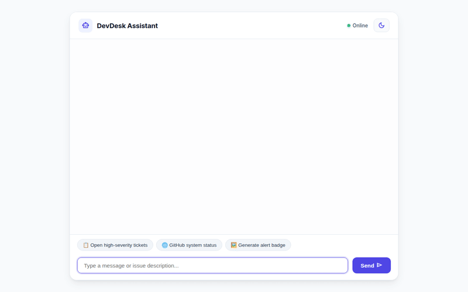

# DevDesk Assistant 🛠️

DevDesk Assistant is an intelligent IT support and developer operations agent built with Google's **Agent Development Kit (ADK)** and deployed on **Vertex AI Agent Engine**. It helps engineering teams triage incidents, manage support tickets, query external system health, generate visual alert badges, and render rich card UIs.



---

## ✨ Features & Capabilities

DevDesk Assistant implements the following capabilities wired directly to Google Cloud services:

* **📋 IT Ticket Management (Firestore)**
  * **Search Tickets**: Filter open or resolved support tickets by severity (`HIGH`, `MEDIUM`, `LOW`) or status (`OPEN`, `IN_PROGRESS`, `RESOLVED`).
  * **Ticket Details**: Fetch complete ticket documentation and resolution history.
  * **Create Ticket**: Log new IT incidents and developer support requests directly in Cloud Firestore.
  * **Update Ticket Status**: Update status and append resolution notes.

* **☁️ Cloud Storage Incident Logs (Cloud Storage)**
  * **Upload Incident Logs**: Upload raw error logs and stack traces directly to a public Google Cloud Storage bucket (`assets/logs/`) and generate public HTTPS reference URLs.

* **🖼️ Visual Alert Badges (Vertex AI Image Generation)**
  * **Generate Support Badges**: Creates custom PNG alert badges and architecture status graphics using Vertex AI Image Generation (`gemini-3.1-flash-lite-image`).
  * **Artifact & Storage Integration**: Saves generated images into the ADK Playground Artifacts panel and uploads memory bytes to Google Cloud Storage.

* **🎬 Incident Status Videos (Gemini Omni Video Generation)**
  * **Generate Incident Animations**: Generates short 16:9 MP4 incident status animation videos using Google's Omni model (`gemini-omni-flash-preview`) in the `global` location.
  * **Artifact & Storage Integration**: Saves video clips to the Playground Artifacts panel and uploads MP4 bytes directly to Google Cloud Storage.

* **🧠 Long-Term Memory (Vertex AI Memory Bank)**
  * **Cross-Session Memory**: Uses `PreloadMemoryTool` and automated memory extraction callbacks to persist user preferences and environment details across conversations.

* **🗺️ Geographic Location & Maps (Google Maps Platform)**
  * **Geocode Address**: Converts street addresses or facility names into geographic coordinates (`latitude`, `longitude`).
  * **Find Nearby Places**: Searches for nearby server rooms, tech support centers, or facilities using Google Maps Places API.

* **🌐 External Health & Code Execution**
  * **GitHub System Status**: Queries live operational status across GitHub services (Git Operations, Actions, API, Copilot).
  * **Python Code Sandbox**: Executes inline mathematical calculations and data transformations safely inside ADK's built-in code execution sandbox.

* **🎨 Rich Display UI (A2UI)**
  * Formats assistant responses using **Agent-to-User Interface (A2UI v0.8)** schemas, rendering structured cards, text columns, and embedded images natively in the chat interface.

---

## 🏗️ Architecture & Stack

* **Framework**: Google Agent Development Kit (ADK `v1.1.0`)
* **Primary LLM**: `gemini-2.5-flash`
* **Video Generation LLM**: `gemini-omni-flash-preview` (`location="global"`)
* **Image Generation Model**: `gemini-3.1-flash-lite-image`
* **Database**: Google Cloud Firestore (NoSQL)
* **Object Storage**: Google Cloud Storage (`devdesk-assistant-assets-qwiklabs-gcp-01-f14e23f8d70e`)
* **Memory Management**: Vertex AI Memory Bank
* **Deployment Target**: Vertex AI Agent Engine (Agent Runtime)
* **Frontend**: Custom FastAPI A2A proxy with responsive chat interface and built-in A2UI card renderer

---

## 🚀 Getting Started

### Prerequisites

1. Python 3.10+ and `uv` package installer
2. Google Cloud SDK (`gcloud` CLI) authenticated to your GCP project
3. `agents-cli` v1.1.0+ (`pip install google-agents-cli`)

### Environment Setup

Set up your required environment variables:

```bash
export GOOGLE_CLOUD_PROJECT="your-gcp-project-id"
export GOOGLE_CLOUD_LOCATION="us-central1"
export GOOGLE_GENAI_USE_VERTEXAI="true"
export GOOGLE_MAPS_API_KEY="<YOUR_MAPS_KEY>"
```

### Local Development

1. **Install Dependencies**:
   ```bash
   pip install -r requirements.txt
   ```

2. **Run Local Agent Web UI (ADK Web)**:
   ```bash
   acli run
   ```

3. **Run Custom FastAPI Frontend Proxy Locally**:
   ```bash
   export AGENT_DIRECTORY="app"
   python main.py
   ```

---

## 📦 Deployment

### Deploying the Agent to Vertex AI Agent Engine

To deploy the agent runtime to Google Cloud:

```bash
agents-cli deploy --no-confirm-project
```

### Deploying the Custom Frontend to Cloud Run

To build and ship the chat UI to Cloud Run:

```bash
gcloud run deploy devdesk-assistant-frontend \
  --source ./frontend \
  --region us-central1 \
  --allow-unauthenticated \
  --set-env-vars AGENT_ENGINE_RESOURCE_NAME="<AGENT_ENGINE_RESOURCE_NAME>",AGENT_DIRECTORY="app"
```

Grant the Cloud Run service account access to invoke Reasoning Engines:

```bash
gcloud projects add-iam-policy-binding $GOOGLE_CLOUD_PROJECT \
  --member="serviceAccount:PROJECT_NUMBER-compute@developer.gserviceaccount.com" \
  --role="roles/aiplatform.user"
```

---

## 📄 License

Apache License 2.0 - See LICENSE for details.
